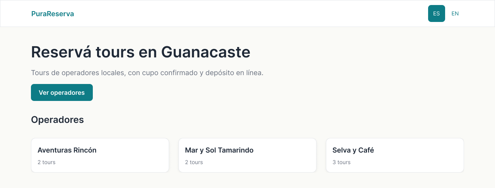
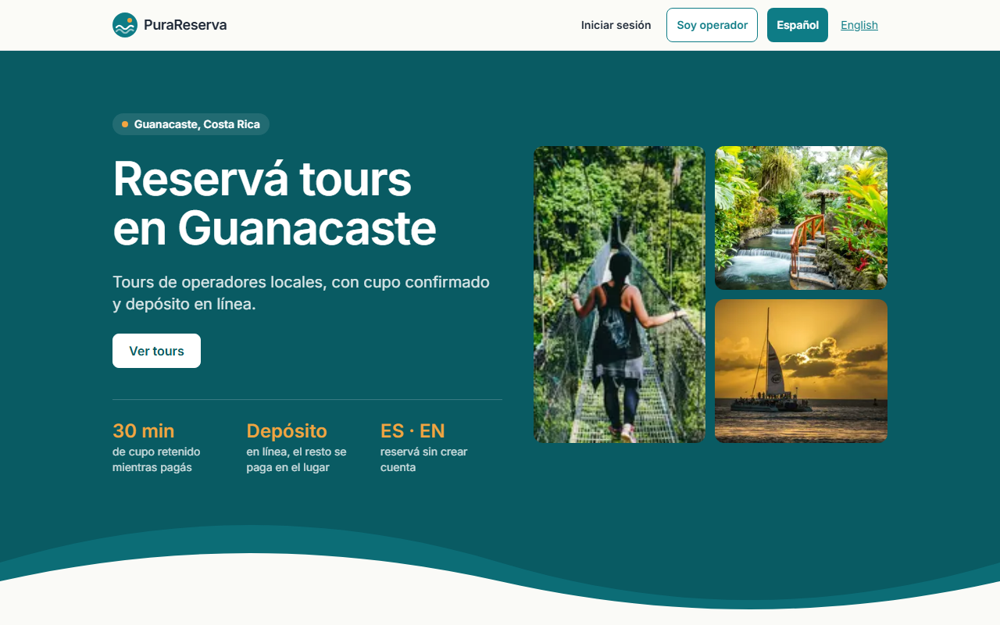
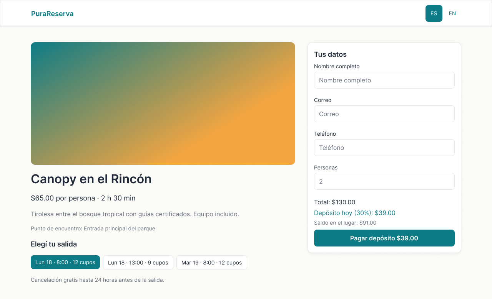
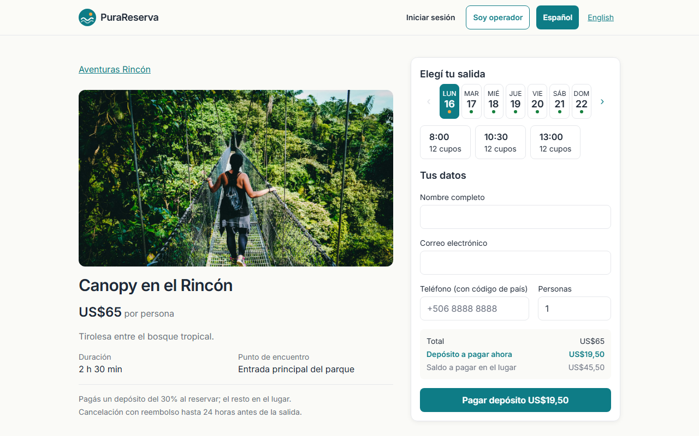
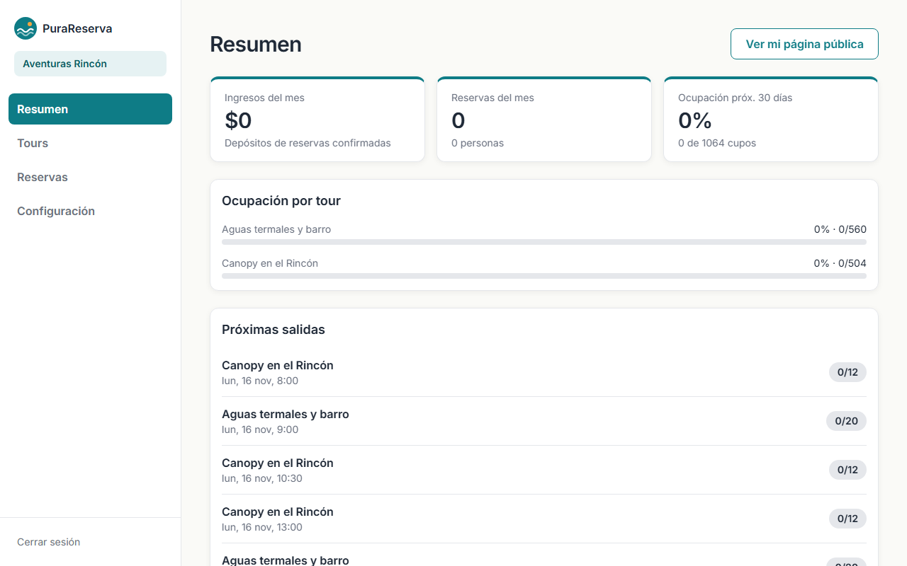
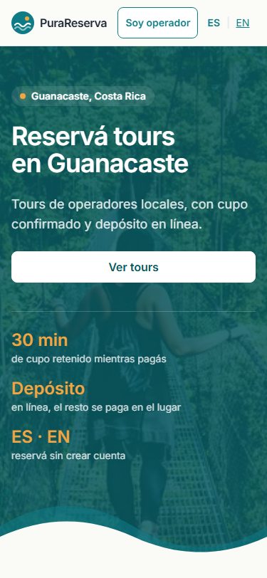
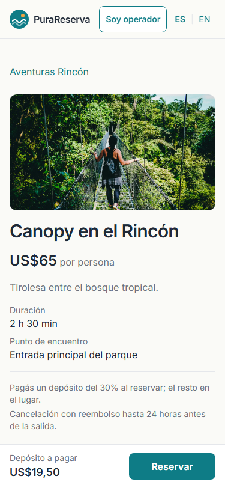

# PuraReserva

Plataforma de reservas para tour operadores de Guanacaste, Costa Rica.

Cada negocio se registra, publica sus tours y programa salidas con cupo. Los turistas reservan sin crear cuenta, en español o en inglés, y pagan un depósito en línea. El resto se paga en el lugar. El dueño ve su agenda, sus ingresos y la ocupación de sus salidas.

Es un proyecto de portafolio. Todo funciona de punta a punta en modo prueba. No se cobra dinero real.

v1.1: mejoras de experiencia, SEO y accesibilidad.

## Demo

- Sitio: https://purareserva.vercel.app
- Diseño en Figma: https://www.figma.com/design/O9gzDxeKp1ITpZY2mcMG03

Para entrar al panel del dueño, usá uno de estos usuarios en `/login`:

| Usuario           | Contraseña   | Negocio             |
| ----------------- | ------------ | ------------------- |
| `dueno1@test.com` | `Prueba123!` | Aventuras Rincón    |
| `dueno2@test.com` | `Prueba123!` | Mar y Sol Tamarindo |

Para probar el pago, reservá un tour y usá la tarjeta de prueba `4242 4242 4242 4242`, cualquier fecha futura y cualquier CVC.

Las salidas de la demo se cargaron con 14 días por delante. Pasado ese plazo hay que programar salidas nuevas desde el panel.

## Capturas

Diseño en Figma y resultado en la app:







Panel del dueño y versión móvil:



 

## Qué incluye

- Registro e inicio de sesión del dueño. El registro crea su negocio con una URL propia (`/es/<slug>`).
- Configuración del negocio: textos ES/EN, WhatsApp, % de depósito y horas límite para cancelar con reembolso.
- Tours con textos ES/EN, precio, duración, cupo, punto de encuentro e imagen.
- Salidas una por una o en lote (rango de fechas, días de la semana y hora).
- Parte pública bilingüe: negocios, tours, salidas con cupos libres y formulario de reserva.
- Pago del depósito con Stripe Checkout y confirmación por webhook.
- Correos de confirmación y cancelación, en el idioma del turista.
- Página de la reserva por enlace secreto. Si se cancela antes del límite, el depósito se reembolsa solo.
- Panel con ingresos del mes, ocupación de los próximos 30 días, próximas salidas y reservas con filtros.

## Stack

| Tecnología                         | Uso                                                          |
| ---------------------------------- | ------------------------------------------------------------ |
| Next.js 15 (App Router) y React 19 | Parte pública y panel en una sola app, con Server Actions    |
| TypeScript                         | Tipos de punta a punta, también los generados desde Supabase |
| Tailwind CSS 4                     | Estilos y responsive                                         |
| Supabase                           | Postgres, Auth, RLS y Storage                                |
| next-intl                          | Rutas `/es` y `/en`                                          |
| Stripe                             | Checkout del depósito, webhooks y reembolsos                 |
| Resend                             | Correos transaccionales                                      |
| Zod                                | Validación de todas las entradas del servidor                |
| Vitest y Playwright                | Pruebas unitarias y end-to-end                               |
| GitHub Actions y Vercel            | CI y despliegue                                              |

## Decisiones de diseño

### Sin sobreventa

La función `crear_reserva` corre dentro de la base de datos. Bloquea la fila de la salida mientras cuenta los cupos, así que dos reservas simultáneas por el último cupo no pueden ganar las dos. Cuenta como ocupado lo confirmado y lo pendiente que no venció. Una reserva pendiente retiene el cupo 30 minutos.

`scripts/concurrencia.ts` lo comprueba: lanza 10 reservas en paralelo sobre una salida con cupo 3 y verifica que se creen exactamente 3.

### Varios negocios con RLS

Todas las tablas tienen Row Level Security. El dueño solo lee y escribe lo de su negocio. El público solo ve negocios y tours activos y salidas futuras. Las reservas no se pueden leer sin sesión.

Las operaciones del sistema (crear la reserva, confirmar el pago, cancelar) usan la service role, solo en el servidor. Esa clave nunca llega al navegador.

### Depósito con Stripe

El precio, el total y el depósito se calculan en la base, nunca en el cliente. Stripe cobra el depósito en Checkout. El resto se paga en el lugar.

La reserva se confirma solo por webhook, con la firma verificada. Cada evento se registra en una tabla de idempotencia, así que un reenvío no hace nada. Los reembolsos usan una clave de idempotencia.

### Reservas sin cuenta

Al reservar se genera un token aleatorio de 32 bytes. El turista lo recibe en su enlace y la base guarda solo su hash SHA-256. Quien tenga el enlace puede ver y cancelar la reserva.

### Otras decisiones

- Dinero en centavos de USD, siempre como entero.
- Fechas en `timestamptz`, mostradas en `America/Costa_Rica`.
- Si falla el envío de un correo, se registra el error y el flujo sigue.

## Correrlo en local

Necesitás:

- Node.js 22 o superior.
- Docker en ejecución.
- [Supabase CLI](https://supabase.com/docs/guides/cli).
- [Stripe CLI](https://docs.stripe.com/stripe-cli) con la sesión iniciada (`stripe login`) en tu cuenta en modo prueba.
- Una clave de API de [Resend](https://resend.com) (se puede crear gratis).

1. Instalar dependencias:

   ```bash
   npm ci
   ```

2. Levantar la base local. Aplica las migraciones y carga los datos de prueba:

   ```bash
   supabase start
   supabase db reset
   ```

3. Crear el archivo de variables:

   ```bash
   cp .env.example .env.local
   ```

   Completar `.env.local`:

   | Variable                        | De dónde sale                                              |
   | ------------------------------- | ---------------------------------------------------------- |
   | `NEXT_PUBLIC_SUPABASE_URL`      | Ya viene con el valor local. `supabase status` la confirma |
   | `NEXT_PUBLIC_SUPABASE_ANON_KEY` | `supabase status -o env` (`ANON_KEY`)                      |
   | `SUPABASE_SERVICE_ROLE_KEY`     | `supabase status -o env` (`SERVICE_ROLE_KEY`)              |
   | `STRIPE_SECRET_KEY`             | Stripe Dashboard en modo prueba, Developers, API keys      |
   | `STRIPE_WEBHOOK_SECRET`         | Lo imprime `stripe listen` (paso 4)                        |
   | `RESEND_API_KEY`                | Resend, API Keys                                           |
   | `EMAIL_FROM`                    | Ya viene con el remitente de prueba de Resend              |

   Con `onboarding@resend.dev`, Resend solo entrega correos al dueño de la cuenta. Con los correos de prueba de la demo, el envío falla y se registra, y la reserva sigue igual. Para entregar a cualquier destinatario hay que verificar un dominio en Resend y cambiar `EMAIL_FROM`.

4. En otra terminal, reenviar los webhooks de Stripe a la app. Copiá el `whsec_...` que imprime a `STRIPE_WEBHOOK_SECRET`:

   ```bash
   stripe listen --events checkout.session.completed,checkout.session.expired --forward-to localhost:3000/api/stripe/webhook
   ```

5. Arrancar la app:

   ```bash
   npm run dev
   ```

   Abrí http://localhost:3000. Los usuarios de prueba son los mismos de la demo.

## Pruebas

| Comando                                                 | Qué corre                                                                            |
| ------------------------------------------------------- | ------------------------------------------------------------------------------------ |
| `npm run lint`                                          | ESLint                                                                               |
| `npm run typecheck`                                     | Tipos de TypeScript                                                                  |
| `npm run test`                                          | Pruebas unitarias con Vitest (dinero, fechas, salidas, tokens, cancelación, correos) |
| `npm run test:e2e`                                      | Pruebas end-to-end con Playwright, en escritorio y en iPhone 13                      |
| `npx tsx --env-file=.env.local scripts/concurrencia.ts` | Comprueba que no hay sobreventa con 10 reservas en paralelo                          |

Para las pruebas e2e necesitás la base local en marcha (`supabase start`) y `.env.local` completo. Playwright compila y arranca la app solo. La primera vez:

```bash
npx playwright install chromium
```

Dos pruebas de pago con tarjeta real quedan saltadas. Para correrlas, con `stripe listen` activo:

```bash
E2E_STRIPE_REAL=1 npm run test:e2e
```

El CI de GitHub Actions corre lint, tipos, pruebas unitarias y compilación, y después las pruebas e2e sobre una base local. Necesita los secretos `STRIPE_SECRET_KEY` y `RESEND_API_KEY` en el repositorio.

## Despliegue

La demo corre en Vercel, con Supabase Cloud y Stripe en modo prueba.

1. `supabase link --project-ref <ref>` y `supabase db push`.
2. En Supabase Auth: Site URL y Redirect URLs al dominio de Vercel (`/auth/callback`), con la confirmación de correo activa.
3. En Vercel: cargar las 8 variables de `.env.example` con la URL de producción.
4. En Stripe: crear un endpoint `https://<dominio>/api/stripe/webhook` con los eventos `checkout.session.completed` y `checkout.session.expired`, y poner su secreto en `STRIPE_WEBHOOK_SECRET`.
5. Opcional, solo para una demo: cargar `supabase/seed.sql` en la base de producción.

Vercel necesita Node 22. Está fijado en `engines` de `package.json`.

## Límites conocidos

- Todo opera en modo prueba de Stripe. El depósito lo cobra la cuenta de la plataforma, sin Stripe Connect.
- Un usuario tiene un solo negocio.
- Todos los negocios están en Costa Rica: zona `America/Costa_Rica` y moneda USD.
- Las fotos de la demo son de Unsplash, de uso libre. Son ilustrativas y no son de operadores reales.

## Estructura

```
src/app/[locale]/   parte pública bilingüe
src/app/panel/      panel del dueño
src/app/(auth)/     login y registro
src/app/api/        webhook de Stripe
src/components/     ui, publico y panel
src/lib/            lógica: dinero, fechas, salidas, tokens, cancelación, Stripe, correos
supabase/           migraciones y datos de prueba
tests/              unitarias y end-to-end
scripts/            concurrencia, webhook, correos y capturas
```

El plano completo del proyecto está en [`blueprint.md`](blueprint.md).
